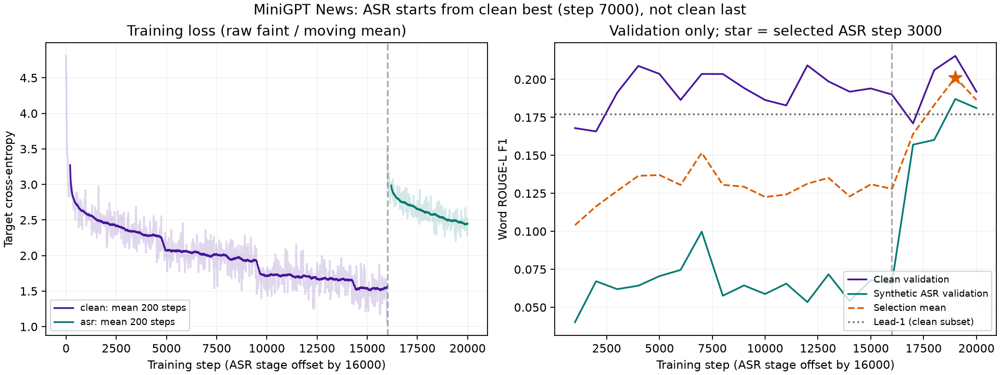

# T1.6c–d — News output review, 2026-10-15

**Training/download/audit COMPLETE. ROUGE-L acceptance PASS. Full Mini-GPT DoD remains PARTIAL:
human evaluation on real ASR transcripts is pending.** Subsequent local integration is now verified in [T1.6e report](T1.6e_bao_cao.md). The review below records the pre-integration findings; no commit/push.

## Checkpoint and downloaded output

Private Kaggle job `traininghighlight/ai-core-minigpt-news` v2: **COMPLETE**, Tesla T4/fp16,
**3.0383 hours**. Clean16000 steps +ASR4000 steps; seed1337.
Stage2 started from the clean **best step7000**, not clean last16000.
The final exported checkpoint is **ASR best step3000**, chosen only from validation.

- Output root: `D:/data_training_ai/minigpt_news/output-v2/`.
- Candidate: `news_run/minigpt/best.pt` (**55,197,377 bytes**) and `bpe_vocab.json`.
- SHA-1: `656acdd50eaeacbcf45a00b02edeb77ba69447b5`.
- SHA-256: `cf9cfa7141d40f9d40b0065ae68855ff39ffe750260ee7b42c7c0eac719330ac`.
- Includes best/last for both stages, both YAML configs, TensorBoard events,20 validation rows,
 1000 test predictions, final metric JSON and kernel log.
- Metadata: [checkpoint manifest](../data/manifests/minigpt_news_checkpoint.json),
 [training manifest](../data/manifests/minigpt_news_training.json),
 [frozen dataset manifest](../data/manifests/minigpt_news_dataset.json).

## Frozen test:1000 News articles → editorial headlines

| Metric, mean F1 | Mini-GPT | Lead-1 | Difference |
|---|---:|---:|---:|
| ROUGE-1 |0.212911|0.212423|+0.000488|
| ROUGE-2 |0.108957|0.113325|−0.004368|
| **ROUGE-L** |**0.202308**|**0.187109**|**+0.015199**|

**ROUGE-L improves1.52 percentage points.** Paired bootstrap2000 resamples/seed1337:
95% interval for the mean difference **[+0.003965,+0.026687]**, excluding zero.
The resampling unit is an article; this interval does not account for near-duplicate stories
that exact body hashing may not identify.

Model wins/ties/loses against Lead-1 on **497/39/464** articles.
**226/1000** predictions have ROUGE-L0; **0** empty predictions; **1** exact headline match.
Zero overlap is a lexical metric result, not a measured hallucination rate.
Teacher-forced target perplexity on the same1000 examples: **11.7081**, CPU/fp32,15444 target tokens
(including EOS). This uses a different corpus/objective from pretrain PPL21.20 and is not directly comparable.

Scoring uses the existing whitespace-token ROUGE-L F1 implementation and matching ROUGE-1/2 F1
with clipped n-gram counts; no new case/punctuation normalization. Lead-1 receives the same visible
source as the model and retains the full first sentence, without the old80-character cut.
Inputs are capped to the fixed512-token sample budget with96 reserved output tokens.
Primary protocol and test checksum were frozen before training; no post-test parameter selection.
Do not directly compare these results with the old Wikipedia proxy numbers.

Raw report: [Kaggle metrics](T1.6c_news_metrics.json).
Independent audit, extra metrics and first5 predictions: [audit JSON](T1.6c_news_audit.json).

## Learning and adaptation

Clean best step7000: validation clean/noisy ROUGE-L **0.203596/0.099781**,
selection mean0.151689. ASR best step3000: **0.215474/0.187099**, mean0.201287.
These are the same fixed64 clean and64 synthetic-noisy validation subsets.
ASR adaptation improves the noisy subset by **8.73 points** over the selected clean checkpoint.
This is evidence on synthetic corruption; it is not a real-ASR human evaluation.

Loss keeps falling during clean training while validation fluctuates; training longer did not
give monotonically better generation. ASR step4000 also scores below step3000.
Validation-based selection was necessary; neither final-step checkpoint was selected by default.

[SVG for export](T1.6c_news_curves.svg). Loss: all20k TensorBoard scalar values finite;
faint raw points and200-step moving means. The ASR stage reloads clean best, explaining the boundary.

## Output quality and limits

The automatic headline criterion is met narrowly. It does **not** establish reliable factual summaries:
ROUGE-1 is almost unchanged and ROUGE-2 is worse than Lead-1.
Examples below use the first frozen test items, without choosing favorable outputs.

- An article about La Liga being ranked the world's best league produces
  “LĐBĐ Pháp đoạt giải VĐQG Tây Ban Nha”: wrong entity and claim.
- A Sir Alex/Manchester United retrospective produces
  “Những bóng hồng đáng sợ trên sân nhà”: wrong focus/topic.
- On the first article's body, a direct CPU `<sum>` smoke produces a fictitious
  “Tổng thống Pháp Lavrovia Lavrovia” and repeats content. `<title>` and `<cap>` also generate,
  but successful generation is not a quality PASS.

The model can supply editable suggestions; it is not ready for unsupervised publishing.
Corpus is News, not video transcripts; `<cap>` learned news headlines rather than annotated key moments.
Context512 sampling, exact-prefix deduplication, one seed, and128-example validation limit generalization.
Human rating remains **unmeasured**:30 real ASR-derived summaries ×3 raters, mean≥3/5.
No ratings are inferred from ROUGE or these examples.

## Verification and runtime integration

- Independently verified all1000 IDs/references, reconstructed Lead-1 from frozen inputs,
  rescored every ROUGE-L pair, and reproduced the bootstrap interval exactly.
- Rechecked all three split checksums and cross-split document-ID disjointness.
- Checked both stages' last step counts and best metrics against all20 validation rows.
- Candidate hash matches ASR best; BPE embedded/exported vocabularies match; architecture unchanged
  (d384/6layers/6heads/vocab8192/context1024), strict state loading and finite weights PASS.
- CPU forward over1000 examples and nonempty greedy generation for all3 formats PASS.
  Kernel log contains all4 mathematical sanity PASS lines, no NaN/Inf loss/traceback.
- Local MiniGPT/data regression48 PASS; Go vet/test/build, CMS tsc/Vite and Client tsc/Next FULL build PASS.

**Serving needs a follow-up change before candidate deployment:**
[services.py](../inference-service/app/services.py) currently encodes raw prompts with BOS (line84),
and uses900-token map chunks. The new model was fine-tuned/evaluated with
`<format> source <eos>` and the512/96 budget. Blindly replacing the checkpoint would not reproduce
this evaluation. The raw-prompt path is confirmed by code inspection; it was not modified in this review.

Docker Desktop's Linux engine is unavailable in this session (`dockerDesktopLinuxEngine` pipe absent).
No API/E2E, long-transcript map-reduce, GPU VRAM or real-ASR human evaluation ran here.
Current serving checkpoint was preserved; candidate remains in the downloaded output directory.

Changed: downloaded and audited output; reproducible audit/plot scripts, curves, metrics/manifests/status.
Verified: frozen test1000 and ROUGE-L PASS; checkpoint/BPE/config/val selection/CPU smoke PASS.
Contract touched: no.
Next safe task: align inference prompt/budgets with the trained formats on staging, then real-ASR30×3 evaluation and E2E before deployment.
